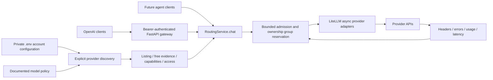

# Routing architecture

## Interfaces and boundaries

`ChatRequest` is the stable input contract. `RoutingService.chat()` returns an OpenAI-style completion plus `routing` metadata. It accepts messages, tools, tool choice, JSON response format, explicit required capabilities, output cap, optional conservative input bound and overall deadline. `model="auto"` enables all compatible deployments; raw model IDs constrain fallback to that model across accounts, and `account/model` IDs pin one deployment. Unknown fields are rejected. Streaming is rejected explicitly.

`config.py` discovers arbitrary numbered keys and reads model allowlists and quota ownership groups. Provider secrets are held in non-repr account objects and passed directly to LiteLLM, never copied into a generated proxy config. Duplicate keys share a group. Missing group configuration defaults to one group per provider. Supplied groups must reflect real shared quotas.

`discovery.py` uses documented provider endpoints and bounded pagination. It intersects allowlists with the catalog, with documented policy overrides for unavailable discovery. The registry separates `listed`, runtime `access`, `free` evidence and capability/context fields. New catalog models do not acquire tool/schema/free eligibility by name guessing. OpenRouter uses advertised parameters and zero pricing. Other providers require explicit model policy and account free-only verification.

Operator model evidence expires after 30 days; catalog evidence expires after 24 hours. An observed exhausted OpenRouter daily counter starts a conservative group cooldown; no midnight reset or remaining capacity is invented. Image/audio inputs imply their capability requirements; unknown content-part types are rejected. Required tool calls must appear in the response before it is accepted.

`engine.py` owns admission, selection, deadlines, retries and cooldown state. Default limits are four active attempts, sixteen waiting callers, one active attempt per quota ownership group and three attempts per logical request. Admission is bounded across active and waiting requests. Selection gives the least-used account a turn, then its least-used deployment, then lower measured latency. Tie-breaking is randomized. Candidate filtering runs before every request; fallback never expands the original candidate set. Waiting is event-driven on releases or nearest cooldown/deadline. There is no background retry storm or provider health polling.

`transport.py` uses `litellm.acompletion`, with retries/caching/parameter dropping disabled. Cloudflare uses LiteLLM's OpenAI adapter against its documented account-scoped endpoint so account IDs do not require global environment mutation. Cohere uses `cohere_chat`. OpenRouter receives parameter-support enforcement and zero upstream price constraints. No client-controlled provider URL, API key or arbitrary LiteLLM options are accepted.

`gateway.py` is a local HTTP adapter. It requires a strong bearer key, disables generated docs, sanitizes validation errors, bounds bodies to 1 MiB, and exposes authenticated model/status endpoints. Only `/healthz` is public and reports process health, not provider readiness. CLI serves loopback with one worker and access logging disabled. Use a TLS reverse proxy before any remote exposure.

## Failure handling

| Signal | Default scope | Action |
|---|---|---|
| 401 | Account alias | Disable for 24h; alternate eligible account may serve request. |
| 402 | Quota group | Cooldown for Retry-After or 1h; no credit purchase or paid fallback. |
| 429 | Quota group | Honor Retry-After or conservative 60s; separate keys in same group stay blocked. |
| 403/404 | Deployment | Mark access denied, cooldown 1h; ambiguity is not resolved by guessing secret error text. |
| 400/413/422 | Request | Return sanitized 400; do not replay malformed requests. |
| 501 | Deployment | Unsupported operation cooldown, preserve capability filter. |
| 502/504 | Provider | Short exponential cooldown; avoid firing all accounts at a likely gateway outage. |
| 408/timeout, 500/503, other errors | Deployment | Bounded fallback with exponential cooldown and positive jitter. |
| Invalid JSON/schema output | Deployment | Reject output, bounded fallback with same schema. |
| Successful response with remaining request/token count <=0 | Quota group | Preemptive cooldown until advertised reset, or conservative 60s. |

These are intentionally conservative scope defaults, not authoritative provider diagnosis. Ambiguous 429 affects the group, and ambiguous 503 affects the deployment. Provider-specific structured error refinements can be added without exposing exception strings. Numeric and HTTP-date Retry-After values and compound reset durations are parsed. Positive jitter never shortens the server's delay. All waits and attempts consume the original deadline. Cancellation releases reservations. A timed-out remote request may still have consumed provider quota; retries are at-least-once and cannot undo remote work.

LiteLLM `UnsupportedParamsError` and `ContextWindowExceededError` are deployment failures even when represented as HTTP 400; they allow compatible fallback. Generic invalid requests stop immediately.

## Implementation priorities completed

1. Secret-safe account discovery and explicit free-use gates before inference.
2. Provider catalog integration and separate capability/access/runtime records.
3. Atomic admission/reservations, account balancing, scoped failure handling and deadlines.
4. Stable Python chat contract, authenticated HTTP adapter and safe metadata.
5. Controlled failure/concurrency tests, bounded live probes and documented evidence gaps.

## Extensions

Add an operation-specific request type, catalog capability and transport method (`litellm.aembedding` or `aimage_generation`) before exposing embeddings/images. Reuse admission, scoped failures, free eligibility and deadlines. Embedding pools must pin dimensions and model identity; image pools must pin output format and size support with independent zero-cost evidence. Do not route non-chat models through `chat()`.

For multiple gateway replicas, first replace admission/cooldown state with an atomic shared store, then add durable budgets/virtual keys through LiteLLM Proxy and PostgreSQL if needed. Keep one layer responsible for retries. Future planner/coder/researcher/reviewer/tester agents should share a single gateway instance and request capabilities explicitly. They own tool validation, permissions, sandboxing and project workflows.
